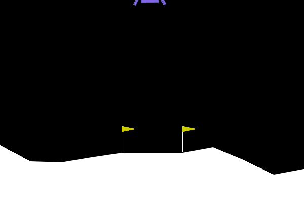
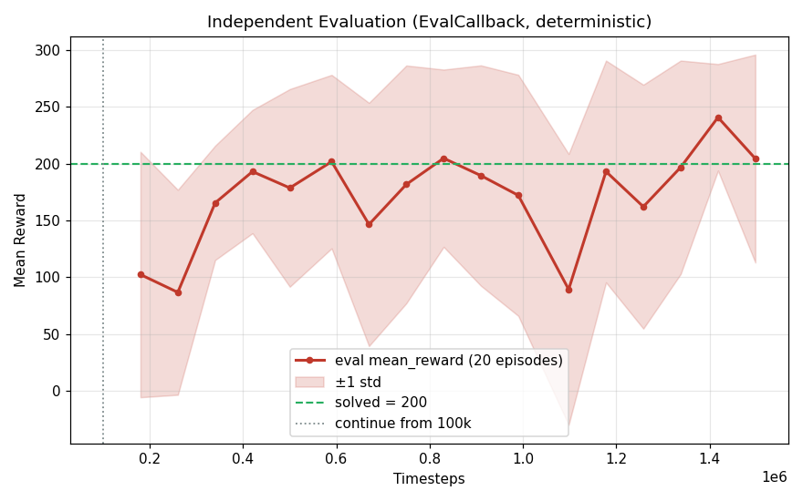
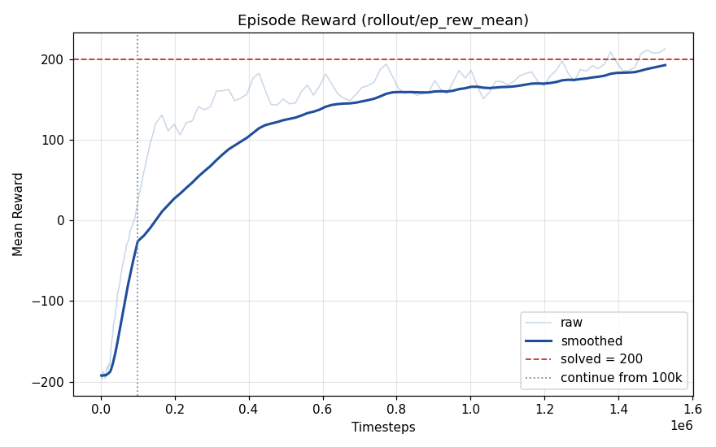
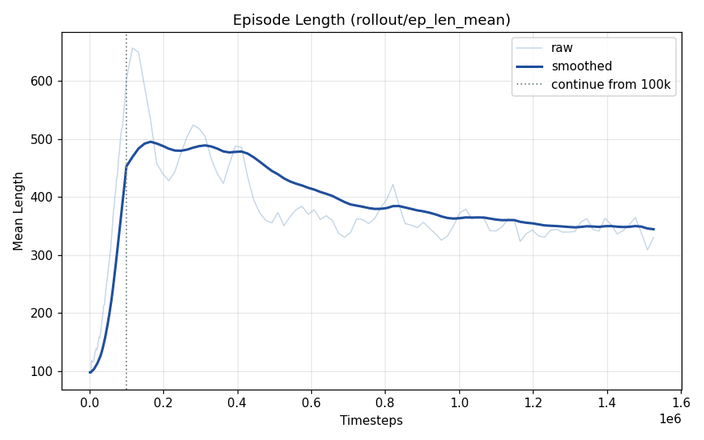
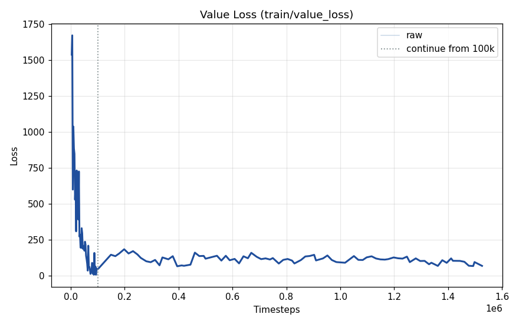
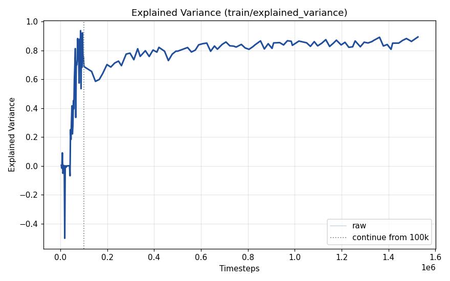
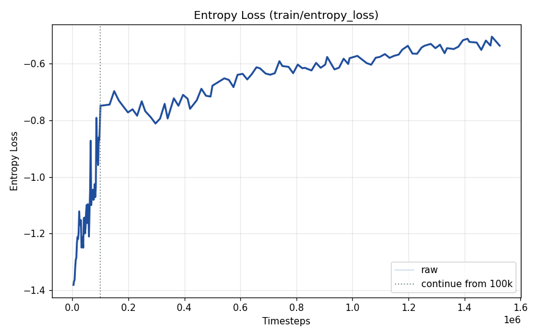

# 🚀 PPO Reinforcement Learning for LunarLander-v3

> An intelligent agent trained to land a spacecraft safely on the moon using **Proximal Policy Optimization (PPO)** — **from +23.5 (未收敛) to 220.7 (officially solved)**.

   

## 🎥 效果展示

最佳模型（100 局复验 **220.7 ± 77.2**）的一次完美着陆，单局得分 264：



---

## 📖 项目简介

此项目利用深度强化学习解决经典的 **LunarLander-v3** 控制问题。通过 **Stable-Baselines3** 的 **PPO** 算法，智能体在离散动作空间下控制主引擎和侧引擎，实现克服月球重力并平稳着陆。

项目完整记录了从**第一轮 100k 步未收敛（+23.5）**，经过诊断、续训、学习率退火，最终在 **1.5M 步达到官方 solved 标准（100 局均值 ≥ 200）**的全过程。训练在 **WSL (Ubuntu 24.04)** 下完成，全程 CPU（MlpPolicy 小网络，瓶颈在物理仿真而非矩阵运算），总训练耗时约 **16 分钟**。

**最终成绩（100 局确定性评估，Gymnasium 官方 solved 判定口径）：**

| 模型 | 平均得分 | 达标局数 (≥200) | 最低分 | 结论 |
|---|---|---|---|---|
| **ppo_lunar_lander_1p5m（最终模型）** | **220.73 ± 77.22** | **88 / 100** | -9.66（无坠毁） | ✅ **SOLVED** |
| best_model（EvalCallback 峰值 @1418k） | 204.30 ± 85.30 | 77 / 100 | -10.82（无坠毁） | ✅ SOLVED |

---

## 🛠️ 环境与算法

### The Environment: LunarLander-v3
* **Goal**: 从屏幕顶部降落至坐标 (0,0) 的着陆台（两面黄旗之间）。
* **State Space (8-dim)**: 坐标 (x, y)、速度 (vx, vy)、角度、角速度、双腿触地传感器。
* **Action Space (Discrete)**: 0: 无操作, 1: 左引擎, 2: 主引擎, 3: 右引擎。
* **Reward**: 安全着陆 +100，坠毁 -100，引擎点火有燃料惩罚；官方 solved 标准为 100 局平均 ≥ 200。

### The Algorithm: PPO (Proximal Policy Optimization)
选择 PPO 的原因：
1. **稳定性**: Clip 机制防止策略更新步幅过大，训练收敛更稳定。
2. **适应性**: Actor-Critic 架构天然适合此类物理控制任务。
3. **行业标准**: PPO 是主流强化学习算法（曾用于 ChatGPT 的 RLHF 训练）。

### 训练配置（最终轮）
| 配置项 | 值 |
|---|---|
| 策略网络 | MlpPolicy（64×64） |
| 并行环境 | 8（SubprocVecEnv，采样 ~1750 fps） |
| n_steps / batch_size / gamma | 2048 / 64 / 0.99 |
| learning_rate | 3e-4（首轮）→ 2e-4（续训）→ **1e-4（退火微调）** |
| 评估 | EvalCallback：每 80k 步独立评估 20 局，自动保存最佳模型 |
| 训练设备 | **CPU**（MLP 小网络 + Box2D 物理仿真在 CPU，GPU 无收益） |

---

## 📊 结果分析

### 训练历程：一次"失败 → 诊断 → 修复"的完整闭环

| 阶段 | 步数 | 独立评估得分（20 局） | 事件 |
|---|---|---|---|
| 第一轮 | 100k | rollout 均值 +23.5 | ❌ 未收敛：学会了不坠毁，没学会着陆 |
| 诊断 | — | 各项指标方向健康（value_loss↓、explained_variance↑） | 结论：纯粹训练量不足（官方建议 ≥500k） |
| 第二轮·续训 | 500k | 峰值 193.0 @420k | 逼近 solved 线但未站稳 |
| 第三轮·加训 | 1.0M | 峰值 204.7 @830k | 首次突破 200，但震荡（172~205） |
| 第四轮·退火 | **1.5M** | **峰值 240.7 ± 46.9 @1418k** | lr 降至 1e-4 抑制震荡，✅ 收敛 |

独立评估全程记录（EvalCallback，deterministic，20 局/点）：



> 最终模型 100 局复验 **220.73 ± 77.22**、88/100 局达标、全程无坠毁——
> 说明 20 局评估选出的"最佳"与 100 局官方口径下的最佳可能不同，**规范验收必须用大样本复验**。

### Key Metrics Analysis（关键指标解读）

#### 1. Episode Reward（rollout/ep_rew_mean）

* 从 -196.8（频繁坠毁）一路上升至 **+213**，平滑曲线在 1.5M 处稳定站上 solved 线（200）。
* 虚线为 100k 续训分界：第一轮曲线仍在爬坡，证明"未收敛"诊断正确，续训决策成立。

#### 2. Episode Length（rollout/ep_len_mean）

* 回合长度 96 → 330+：从"自由落体坠毁"变为"空中姿态调整 + 缓慢受控下降"，是学会控制的典型特征。

#### 3. Value Loss（train/value_loss）

* 从 1670 迅速下降并收敛，Critic 对状态价值的预判越来越准，"自我评价体系"建立。

#### 4. Explained Variance（train/explained_variance）

* 从 -0.50 提升至 **0.89**：价值函数对回报的解释力接近理想值 1，Critic 质量是后期稳定高分的基础。

#### 5. Entropy Loss（train/entropy_loss）

* 策略熵随训练下降并趋于平缓：探索噪声逐渐让位于稳定的最优策略，与退火后评估方差收窄互为印证。

---

## ⚡ 安装与复现

本项目在 **WSL (Ubuntu 24.04)** 下开发（Box2D 在 Windows 原生环境易报错，建议全程 WSL）。

```bash
sudo apt-get update && sudo apt-get install -y swig build-essential python3-dev
python3 -m venv venv && source venv/bin/activate
pip install "gymnasium[box2d]" stable-baselines3 tensorboard matplotlib pillow
```

复现路径（对应本项目四轮训练）：
```bash
python train.py            # 第一轮：100k 基线（+23.5，未收敛）
python train_continue.py   # 第二轮：续训至 500k（EvalCallback 峰值 193）
python train_to_1m.py      # 第三轮：加训至 1M（首次破 200，震荡）
python train_to_1p5m.py    # 第四轮：lr 退火 1e-4 微调至 1.5M（✅ 收敛）
python eval.py --episodes 100   # 官方口径验收：220.73 ± 77.22
python gen_curves.py       # 从 TensorBoard 日志导出本 README 全部曲线
python record_gif.py       # 录制着陆演示 GIF
```

## 📂 Project Structure
```text
.
├── logs/                    # TensorBoard 日志（四轮完整记录）+ EvalCallback 评估数据
├── models/                  # 各阶段模型（100k / 500k / 1M / 1.5M + best/ 冠军们）
├── Images/                  # 训练曲线（由 gen_curves.py 生成）
├── train.py                 # 第一轮训练脚本
├── train_continue.py        # 第二轮续训脚本（PPO.load + EvalCallback）
├── train_to_1m.py           # 第三轮加训脚本
├── train_to_1p5m.py         # 第四轮退火微调脚本
├── eval.py                  # 评估脚本（100 局官方口径）
├── gen_curves.py            # 曲线导出脚本
├── record_gif.py            # GIF 录制脚本
└── lunar_lander_demo.gif    # 着陆演示
```

Run under Linux (WSL) | Powered by Stable-Baselines3
